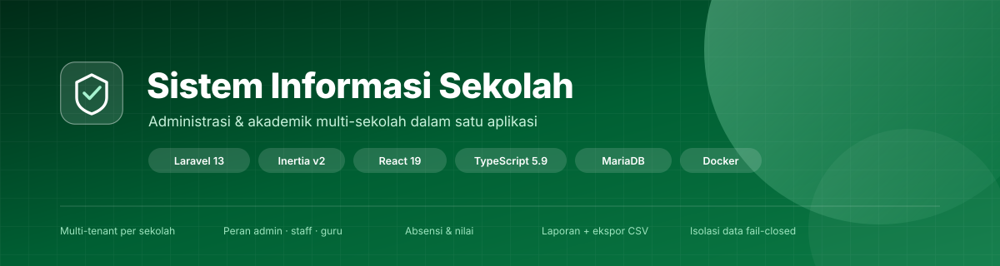
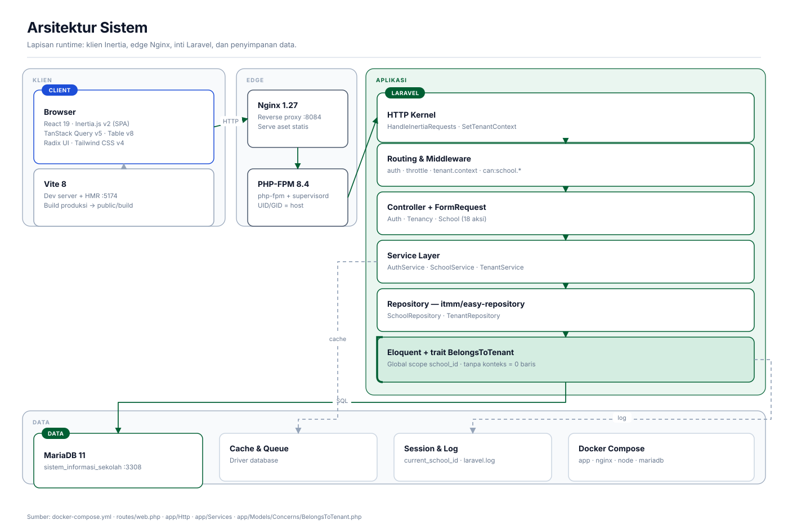
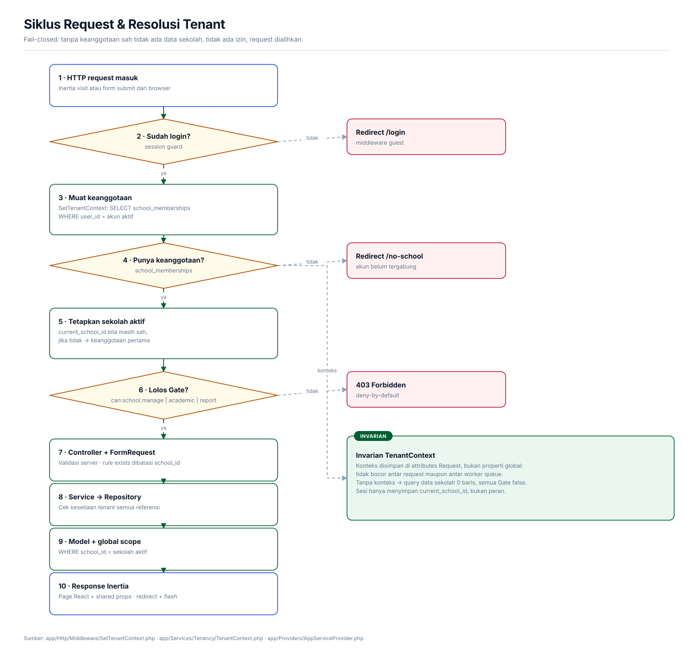
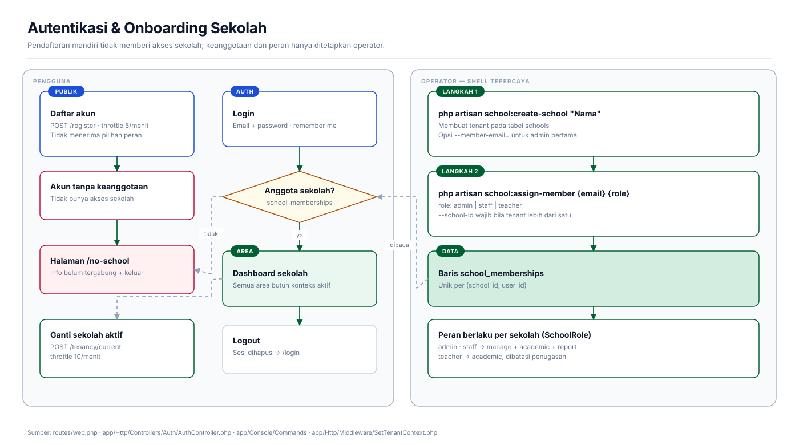
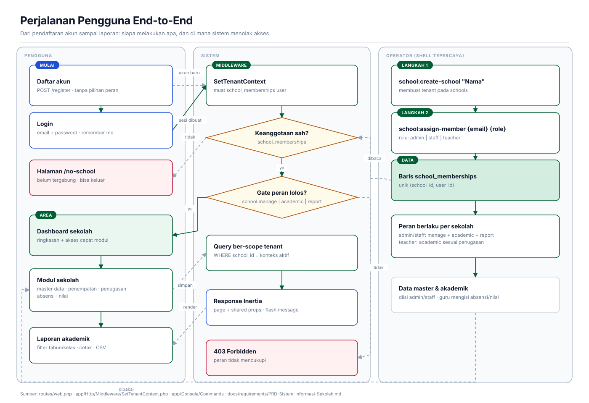
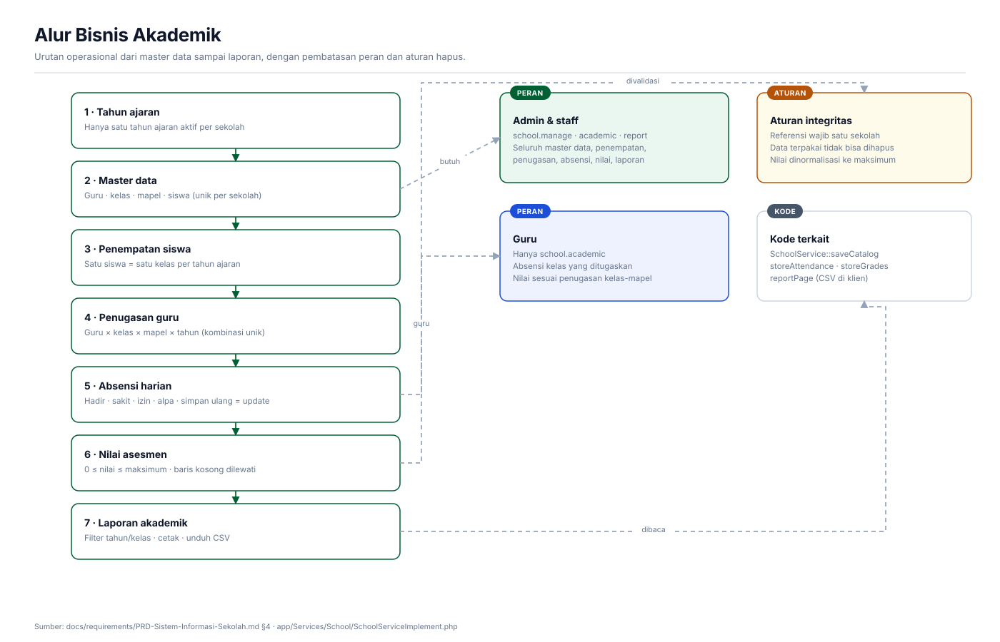
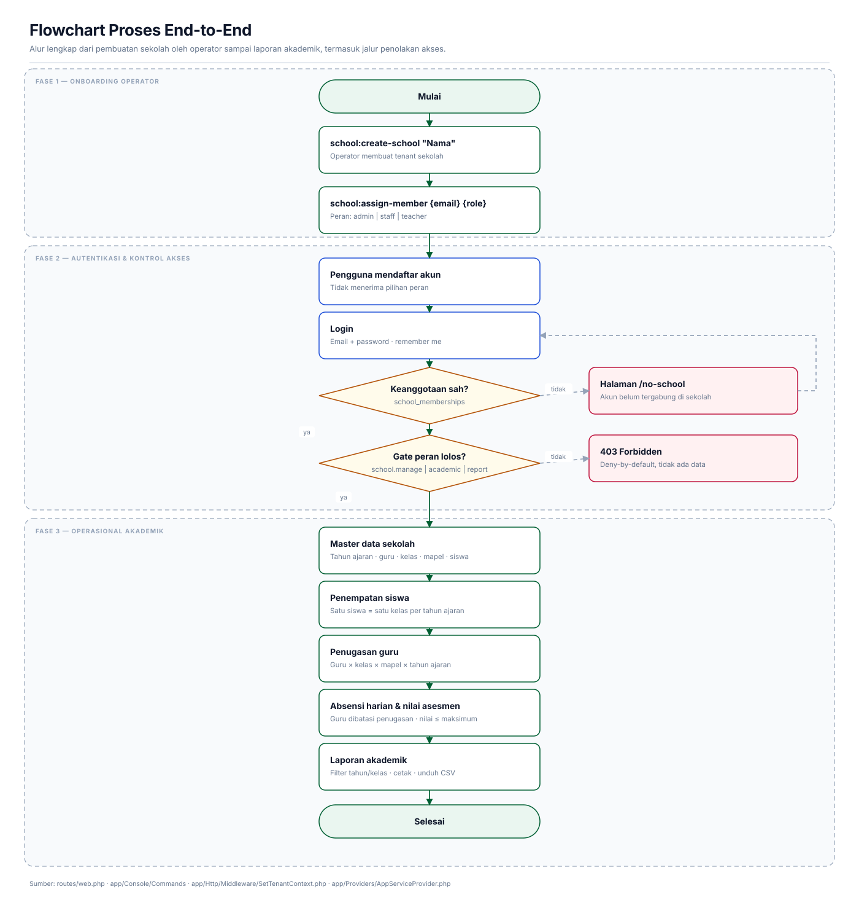
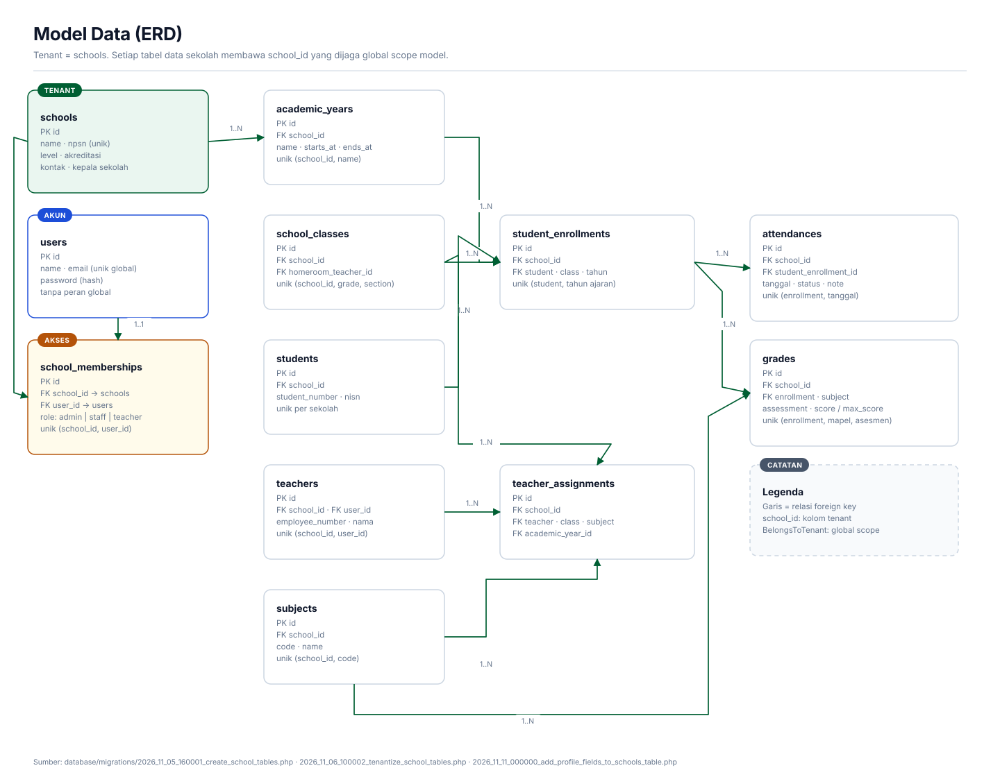

<p align="center">
  
</p>

<p align="center">
  <a href="https://www.php.net/"></a>
  <a href="https://laravel.com/"></a>
  <a href="https://inertiajs.com/"></a>
  <a href="https://react.dev/"></a>
  <a href="https://www.typescriptlang.org/"></a>
  <a href="https://mariadb.org/"></a>
  <a href="https://www.docker.com/"></a>
  <a href="LICENSE"></a>
</p>

<p align="center">
  Aplikasi administrasi dan akademik <strong>multi-sekolah</strong> dalam satu instalasi.<br>
  Master data, penempatan siswa, penugasan guru, absensi, nilai, dan laporan — dengan isolasi data per sekolah.
</p>

---

## Daftar isi

- [Ringkasan](#ringkasan)
- [Fitur](#fitur)
- [Arsitektur](#arsitektur)
- [Alur & diagram](#alur--diagram)
- [Peran & hak akses](#peran--hak-akses)
- [Stack teknologi](#stack-teknologi)
- [Struktur proyek](#struktur-proyek)
- [Menjalankan proyek](#menjalankan-proyek)
- [Onboarding sekolah](#onboarding-sekolah)
- [Perintah umum](#perintah-umum)
- [Pengujian & kualitas kode](#pengujian--kualitas-kode)
- [Keamanan & isolasi tenant](#keamanan--isolasi-tenant)
- [Dokumentasi](#dokumentasi)
- [Lisensi](#lisensi)

---

## Ringkasan

Sistem Informasi Sekolah memusatkan administrasi sekolah dan pencatatan akademik untuk **banyak
sekolah (tenant)** dalam satu aplikasi. Setiap sekolah memiliki data master, keanggotaan, dan data
akademiknya sendiri. Pengguna bisa menjadi anggota lebih dari satu sekolah dengan peran berbeda di
masing-masing sekolah.

Aplikasi ini adalah MVP yang sudah berjalan dan siap dipakai untuk uji operasional. Keputusan
kebijakan sekolah (pendaftaran, peran kepala sekolah, format NIS/NIP, kalender akademik) masih
bersifat sementara dan perlu disahkan sebelum memakai data nyata — lihat
[PRD](docs/requirements/PRD-Sistem-Informasi-Sekolah.md).

| Aspek | Keterangan |
|---|---|
| Model tenant | Tenant = baris `schools`; keanggotaan per sekolah di `school_memberships` |
| Isolasi data | Kolom `school_id` di semua tabel data sekolah + global scope `BelongsToTenant` |
| Fail-closed | Tanpa konteks sekolah: query mengembalikan nol baris, Gate gagal, request dialihkan |
| Autentikasi | Sesi Laravel (email + password, remember me); API auth belum tersedia |
| Onboarding | Pendaftaran mandiri **tidak** memberi akses sekolah; keanggotaan ditetapkan operator lewat Artisan |
| Antarmuka | Inertia.js v2 + React 19 + TypeScript (SPA tanpa API terpisah) |

---

## Fitur

**Tenant & akses**

- Pemilih sekolah aktif; konteks sekolah dibentuk ulang pada setiap request.
- Peran per sekolah: `admin`, `staff`, `teacher`.
- Permission dihitung dari peran sekolah aktif: `school.manage`, `school.academic`, `school.report`.
- Halaman `/no-school` untuk akun yang belum tergabung di sekolah mana pun.

**Master data**

- Profil sekolah: NPSN, jenjang, akreditasi, kontak, kepala sekolah, tahun berdiri.
- Siswa: NIS, NISN, identitas, status — unik per sekolah.
- Guru: nomor pegawai, kontak, status, tautan ke akun login.
- Kelas: tingkat, rombel, wali kelas — unik per sekolah.
- Mata pelajaran: kode dan nama — unik per sekolah.
- Tahun ajaran: periode dan satu tahun ajaran aktif per sekolah.

**Akademik**

- Penempatan siswa: satu siswa satu kelas per tahun ajaran.
- Penugasan guru: kombinasi guru × kelas × mapel × tahun ajaran.
- Absensi harian: hadir, sakit, izin, alpa; menyimpan ulang memperbarui catatan.
- Nilai per asesmen dengan nilai maksimum yang bisa diatur.
- Laporan akademik: filter tahun ajaran/kelas, cetak, dan unduh CSV.
- Data yang sudah dipakai absensi/nilai tidak bisa dihapus.

**Lainnya**

- Autentikasi: login, register, logout, remember me, throttling login/register.
- Modul contoh (`/example/*`) sebagai referensi pola; matikan dengan `EXAMPLE_ENABLED=false`.
- Docker Compose siap pakai: app (PHP-FPM), nginx, node, MariaDB.

---

## Arsitektur

<p align="center">
  
</p>

<p align="center">
  <a href="docs/diagrams/sistem-informasi-sekolah.drawio"><strong>Buka diagram di draw.io</strong></a>
  · 7 halaman: arsitektur, siklus request, autentikasi, alur akademik, perjalanan pengguna,
  flowchart end-to-end, dan ERD.
</p>

Lapisan utama:

1. **Klien** — React 19 + TypeScript, dirender melalui Inertia; state server diambil dengan
   TanStack Query, tabel dengan TanStack Table, komponen Radix/Base UI, styling Tailwind CSS v4.
2. **Edge** — Nginx meneruskan request ke PHP-FPM; aset dibangun Vite (dev server dengan HMR).
3. **Aplikasi** — Laravel 13: middleware (`HandleInertiaRequests`, `SetTenantContext`), routing
   dengan Gate, controller + FormRequest, service, repository (`itmm/easy-repository`), dan model
   Eloquent dengan trait `BelongsToTenant`.
4. **Data** — MariaDB sebagai basis data tenant; cache, queue, dan sesi memakai driver `database`.

---

## Alur & diagram

### Siklus request & resolusi tenant

<p align="center">
  
</p>

Setiap request melewati rantai yang sama: sesi → `auth` → `tenant.context` → Gate → controller →
service → model. Middleware `SetTenantContext` hanya membentuk konteks dari baris
`school_memberships` yang sah. Bila konteks tidak terbentuk, tidak ada data yang bisa dibaca dan
semua Gate bernilai `false`.

### Autentikasi & onboarding sekolah

<p align="center">
  
</p>

Pendaftaran mandiri **tidak** menerima pilihan peran dan tidak mengaitkan akun ke sekolah mana pun.
Keanggotaan hanya dibuat operator melalui `school:create-school` dan `school:assign-member` dari
shell tepercaya.

### Perjalanan pengguna

<p align="center">
  
</p>

### Alur bisnis akademik

<p align="center">
  
</p>

### Flowchart end-to-end

<p align="center">
  
</p>

### Model data (ERD)

<p align="center">
  
</p>

Seluruh tabel data sekolah (`academic_years`, `teachers`, `students`, `school_classes`, `subjects`,
`student_enrollments`, `teacher_assignments`, `attendances`, `grades`) membawa `school_id`
dengan foreign key ke `schools` dan dijaga global scope model.

---

## Peran & hak akses

Peran melekat pada **keanggotaan per sekolah**, bukan pada akun.

| Kemampuan | `admin` | `staff` | `teacher` |
|---|:--:|:--:|:--:|
| Lihat profil sekolah | ✅ | ✅ | ✅ |
| Kelola profil sekolah | ✅ | ✅ | — |
| Master data (siswa, guru, kelas, mapel, tahun ajaran) | ✅ | ✅ | — |
| Penempatan siswa & penugasan guru | ✅ | ✅ | — |
| Absensi | ✅ | ✅ | ✅ (kelas yang ditugaskan) |
| Nilai | ✅ | ✅ | ✅ (pasangan kelas–mapel yang ditugaskan) |
| Laporan akademik | ✅ | ✅ | — |

Gate yang dipakai route: `school.manage`, `school.academic`, `school.report`.

---

## Stack teknologi

| Lapisan | Teknologi |
|---|---|
| Backend | PHP 8.4, Laravel 13, `inertiajs/inertia-laravel` v2, `itmm/easy-repository`, Ziggy |
| Frontend | React 19, TypeScript 5.9 (strict), Inertia.js v2, Vite 8, Tailwind CSS v4 |
| Data & tabel | TanStack Query v5, TanStack Table v8, Radix UI / Base UI, Recharts |
| UI & i18n | `lucide-react`, `sonner`, `react-intl`, `date-fns` |
| Database | MariaDB |
| Infrastruktur | Docker Compose (app PHP-FPM, nginx, node, mariadb) |
| Kualitas kode | PHPUnit 12, Laravel Pint, `tsc --noEmit` |

---

## Struktur proyek

```text
.
├── app/
│   ├── Console/Commands/        # school:create-school, school:assign-member
│   ├── Enums/                   # SchoolRole, AttendanceStatus, StudentStatus, ...
│   ├── Http/
│   │   ├── Controllers/         # Auth, Tenancy, School, Example
│   │   ├── Middleware/          # HandleInertiaRequests, SetTenantContext
│   │   └── Requests/            # validasi per modul
│   ├── Models/Concerns/         # BelongsToTenant (global scope school_id)
│   ├── Providers/               # binding repository + definisi Gate
│   ├── Repositories/            # implementasi itmm/easy-repository
│   └── Services/                # Auth, School, Tenancy
├── database/migrations/         # skema + migrasi tenantisasi
├── docs/
│   ├── diagrams/                # diagram SVG + berkas draw.io
│   ├── requirements/            # PRD
│   └── standard/                # standar backend, frontend, desain
├── resources/js/
│   ├── api/                     # klien HTTP + factory query key
│   ├── layouts/                 # layout auth & main
│   ├── pages/                   # halaman Inertia (auth, school, tenancy, example)
│   └── components/              # komponen UI bersama
├── routes/web.php               # seluruh route aplikasi
├── tests/Feature/School/        # uji isolasi tenant & otorisasi
├── docker-compose.yml
└── docker.sh                    # pembungkus perintah Docker
```

---

## Menjalankan proyek

### Prasyarat

- Docker + Docker Compose v2.20 atau lebih baru
- Port host yang bebas: `8084` (app), `5174` (Vite), `3308` (MariaDB) — dapat diubah di `.env`

### Langkah

```bash
# 1. Siapkan environment
cp .env.example .env

# 2. Jalankan container (app, nginx, node, mariadb)
./docker.sh up

# 3. Siapkan basis data & dependensi
./docker.sh composer install
./docker.sh artisan key:generate
./docker.sh artisan migrate
./docker.sh npm install
```

Aplikasi tersedia di **http://localhost:8084**.

Untuk membangun ulang aset saat pengembangan:

```bash
./docker.sh npm run dev     # Vite dev server + HMR pada port 5174
./docker.sh npm run build   # build produksi ke public/build
```

### Menghentikan

```bash
./docker.sh down            # hentikan & hapus container
./docker.sh logs [service]  # ikuti log (app/nginx/node/mariadb)
```

---

## Onboarding sekolah

Pendaftaran mandiri hanya membuat akun. Agar akun dapat mengakses sekolah, operator harus
menjalankan perintah berikut dari shell tepercaya:

```bash
# 1. Buat tenant sekolah (opsional: langsung tetapkan admin pertama)
docker exec sistem-informasi-sekolah-app php artisan school:create-school "SMA Negeri 1" \
  --member-email=admin@example.test

# 2. Tambahkan anggota lain beserta perannya
docker exec sistem-informasi-sekolah-app php artisan school:assign-member \
  admin@example.test admin --school-id=1

docker exec sistem-informasi-sekolah-app php artisan school:assign-member \
  guru@example.test teacher --school-id=1
```

Catatan:

- Tanpa `--school-id`, perintah hanya berjalan bila tepat satu sekolah ada.
- Keanggotaan baru berlaku pada request berikutnya.
- Akun yang sudah ada **tidak otomatis** menjadi anggota setelah migrasi tenantisasi; tetapkan
  lewat `school:assign-member` sampai saat itu pengguna melihat halaman `/no-school`.

---

## Perintah umum

| Kebutuhan | Perintah |
|---|---|
| Jalankan container | `./docker.sh up` |
| Shell di container app | `./docker.sh shell` |
| Artisan | `./docker.sh artisan <args>` |
| Composer | `./docker.sh composer <args>` |
| npm | `./docker.sh npm <args>` |
| Migrasi | `./docker.sh artisan migrate` |
| Reset + seed | `./docker.sh fresh` |
| Perbaiki permission storage | `./docker.sh permissions` |
| Uji backend | `docker exec sistem-informasi-sekolah-app php artisan test` |
| Code style PHP | `docker exec sistem-informasi-sekolah-app vendor/bin/pint` |
| Type-check frontend | `docker exec sistem-informasi-sekolah-node npx tsc --noEmit` |
| Daftar route | `./docker.sh artisan route:list --except-vendor` |

---

## Pengujian & kualitas kode

```bash
# Test backend (PHPUnit)
docker exec sistem-informasi-sekolah-app php artisan test

# Code style PHP (Pint)
docker exec sistem-informasi-sekolah-app vendor/bin/pint

# Type-check frontend (TypeScript strict)
docker exec sistem-informasi-sekolah-node npx tsc --noEmit
```

Fokus pengujian saat ini ada pada isolasi tenant dan otorisasi route
(`tests/Feature/School/TenantIsolationTest.php`): data sekolah lain tidak dapat dijangkau, guru
tidak dapat membuka route manajemen, dan akun tanpa keanggotaan diarahkan ke `/no-school`.

---

## Keamanan & isolasi tenant

- **Deny-by-default.** Tanpa konteks sekolah: query data sekolah mengembalikan nol baris, seluruh
  Gate gagal, dan request dialihkan ke `/no-school`.
- **Konteks per request.** `TenantContext` disimpan pada atribut `Request`, sehingga tidak bocor
  antar request maupun antar worker.
- **Sesi hanya menyimpan `current_school_id`**, dan nilai itu dipakai hanya bila masih cocok dengan
  keanggotaan yang sah.
- **Validasi server.** FormRequest membatasi rule `exists`/`unique` ke sekolah aktif; service
  memeriksa ulang kesetiaan tenant seluruh referensi sebelum menyimpan.
- **Tanpa peran dari input publik.** Role tidak diterima dari form register maupun request biasa.
- **Proteksi umum.** Password di-hash, CSRF aktif, sesi diregenerasi saat login, login/register
  dibatasi 5 percobaan per menit, ganti sekolah 10 per menit.

Untuk produksi: aktifkan HTTPS, backup rutin, batasi akses server, dan set `EXAMPLE_ENABLED=false`.

---

## Dokumentasi

| Dokumen | Isi |
|---|---|
| [PRD](docs/requirements/PRD-Sistem-Informasi-Sekolah.md) | Tujuan, cakupan MVP, peran, aturan bisnis, model tenant |
| [BACKEND-STANDARD](docs/standard/BACKEND-STANDARD.md) | Standar kode backend (route, service, repository, test) |
| [FRONTEND-STANDARD](docs/standard/FRONTEND-STANDARD.md) | Standar kode frontend (struktur, query key, tipe) |
| [DESIGN-STANDARD](docs/standard/DESIGN-STANDARD.md) | Standar tampilan, token warna, komponen |
| [Diagram draw.io](docs/diagrams/sistem-informasi-sekolah.drawio) | 7 halaman diagram yang dapat diedit |

---

## Lisensi

Dirilis di bawah [MIT License](LICENSE).
